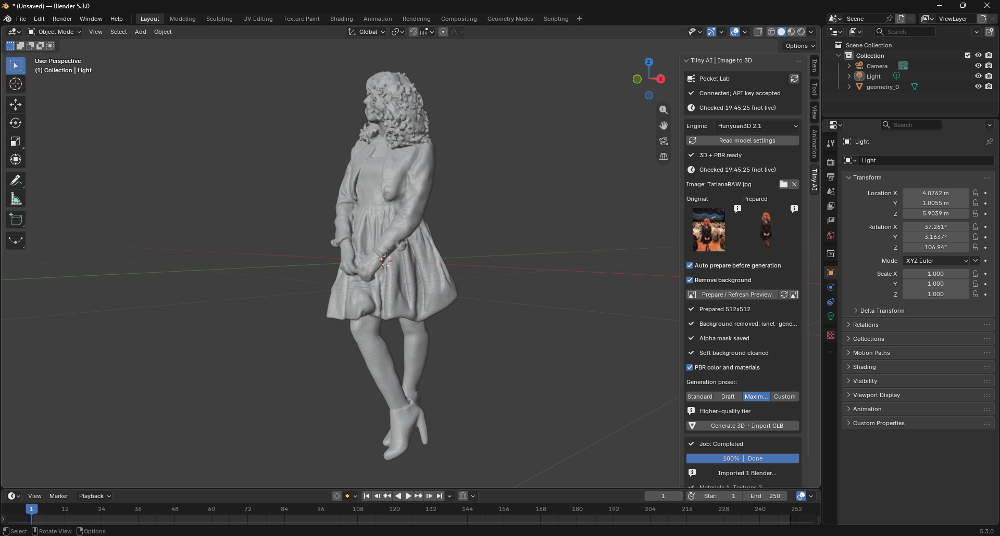
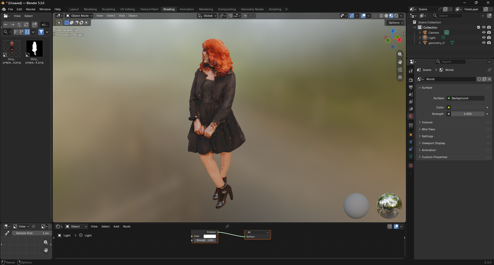

# Tiiny AI for Blender

**Turn photographs and reference images into textured 3D models in Blender, powered by your local Tiiny AI Pocket Lab.**

**First Community Preview · v0.1.0 · Blender 4.3+ · MIT License**

[**Download the Blender extension (.zip)**](https://github.com/US4LKW/tiiny-ai-for-blender/releases/download/v0.1.0/tiiny_ai_for_blender-0.1.0.zip) · [**Illustrated User Guide**](docs/USER_GUIDE.md) · [Release Notes](https://github.com/US4LKW/tiiny-ai-for-blender/releases) · [Report an Issue](https://github.com/US4LKW/tiiny-ai-for-blender/issues)

> **Independent community project.** This is not an official product of Blender, Tiiny AI, Tencent, or Microsoft. A compatible Tiiny AI Pocket Lab is required for 3D generation. The extension does not itself run the 3D models on your computer, and no separate Blender MCP server is required.

## What can it do?

- Generate 3D geometry from an image with **Tencent Hunyuan3D 2.1** or **Microsoft TRELLIS.2 4B** running on Tiiny.
- Optionally generate **PBR colors and materials** and automatically import the resulting **GLB** into Blender.
- Prepare an ordinary photo with optional local **background removal, alpha-mask cleanup, cropping, centering, and resizing**.
- Turn the local image tools **off** to send a self-prepared image directly to Tiiny.
- Choose **Draft, Standard, Maximum, or Custom** quality, with model-specific controls sourced from the Tiiny API.
- View step-by-step progress, cancel local waiting, and save diagnostic information for troubleshooting.
- Save generated models to a folder of your choice.

### At a glance

| Feature | Details |
| --- | --- |
| Blender | Version **4.3 or newer** (demonstrated with Blender 5.3) |
| 3D engines | `Tencent/Hunyuan3d-2.1`, `microsoft/TRELLIS.2-4B` |
| 3D computation | Runs on **Tiiny AI Pocket Lab** |
| Optional image preparation | Local ISNet/rembg tools; initial Internet download required |
| Output | GLB geometry with optional PBR materials |
| Control | Direct Tiiny API; **no external MCP bridge required** |
| License | MIT — see [LICENSE](LICENSE) and [credits](#license-credits-and-image-rights) |

## How This Project Began

The idea began when I watched a Tiiny AI video: **[Tiiny x Blender: Limit Less, Create More](https://youtu.be/zodag03kS6o)**.

I loved the idea of using a compact local AI device with Blender and wanted to try the integration myself. I asked where to find the demonstrated add-on and eventually learned that some members of the community had built their own solutions. So I decided to create one for my own Tiiny AI Pocket Lab.

### Putting Image-to-3D to a Real-World Test

While exploring other image-to-3D demonstrations, I noticed that many authors used simple, recognizable objects — often a rubber duck. A duck is a good introductory test: it has a distinctive silhouette, smooth surfaces, and bright colors. But such a simple example does not show every challenge these models face.

**I wanted to see what would happen with a real photograph that was never prepared for 3D reconstruction.**

For this experiment, I chose a photograph of my friend **Tatiana**, who gave me permission to use her image in this project and its public demonstration. The photo includes a busy background, a natural pose, a turned head, curly hair, layered clothing, and many small details. It challenges the automatic background-removal tool as well as the 3D model.

I did not isolate the subject manually in Photoshop. I loaded the original photo, let the add-on remove the background and prepare the input, and generated a model using **Hunyuan3D 2.1 on Tiiny**.

**The very first attempt surprised me:** the result was recognizable, detailed, and textured. It was not flawless — reconstructing a person from one view is inherently difficult — but it was far better than I expected.

*Hunyuan3D 2.1 result in Blender's Material Preview. Demonstration published with the subject's permission.*

### Why automatic image preparation matters

During development I discovered that small shadows, weak alpha pixels, background clutter, and framing can become unwanted geometry. I wanted to reduce the need for repetitive manual editing, so I integrated optional local image-preparation tools into the add-on.

They can remove a background, clean weak mask residues, center and crop a subject, and produce a prepared PNG. **You remain in control:** uncheck **Use local image tools** in Preferences and use your own reference image without local segmentation or resizing.

## Supported 3D engines

**Hunyuan3D 2.1** has produced particularly good results for my more complex images, including this human figure. It supports geometry generation followed by optional texture creation and GLB export.

**TRELLIS.2 4B** is a fast and interesting alternative, especially worth experimenting with for simpler objects. It can also produce holes, unwanted internal surfaces, and other geometry artifacts on some inputs. Its **1024/high** path is experimental on Tiiny; the add-on includes a separate confirmation control for that mode.

Because TRELLIS.2 has many configurable parameters, I kept advanced controls accessible. If you find better preset combinations or a reliable way to reduce mesh artifacts, please share your results in [Issues](https://github.com/US4LKW/tiiny-ai-for-blender/issues) or Discussions after they are enabled.

## Quick installation

1. Download **[`tiiny_ai_for_blender-0.1.0.zip`](releases/tiiny_ai_for_blender-0.1.0.zip)**. **Do not extract it.** Do not install GitHub's automatically generated repository ZIP as the Blender extension.
2. In Blender, open **Edit → Preferences → Get Extensions**. Open the menu and choose **Install from Disk**.
3. Select the extension ZIP and enable **Tiiny AI** if prompted.
4. Find **Tiiny AI** under **Preferences → Add-ons**. Enter the Tiiny API address (for example `http://tiinyhost.local`) and your personal API key. Never publish your key.
5. Choose an input folder and an output folder, select Hunyuan3D or TRELLIS.2, then test the connection and read the selected model's capabilities.
6. In the 3D Viewport, press **N**, open the **Tiiny AI** sidebar, choose an image and click **Generate 3D + Import GLB**.

If **Use local image tools** is enabled (the default), the add-on first sets up a private local environment and an ISNet segmentation model. The first download may take several minutes. The status is displayed in Blender; later runs reuse the cache. You can disable the local tools and work with an already prepared image immediately.

**[Follow the illustrated installation, use, and removal guide →](docs/USER_GUIDE.md)**

## Documentation

- **[Complete Illustrated User Guide](docs/USER_GUIDE.md)** — installation, API configuration, image preparation, generation, shading, updates, and uninstalling, with step-by-step screenshots.
- [Technical Installation Notes](docs/INSTALLATION.md)
- [Model API Parameters](docs/API_PARAMETERS.md)
- [Mask Cleanup](docs/IMAGE_MASK_CLEANUP.md)
- [TRELLIS Diagnostics](docs/TRELLIS_DIAGNOSTICS.md)
- [Network and Cancellation](docs/NETWORK_AND_CANCELLATION.md)
- [Troubleshooting Image Preparation](docs/PREVIEW_BACKGROUND_TROUBLESHOOTING.md)
- [Development History](docs/DEVELOPMENT_HISTORY.md)
- [First Release Notes](RELEASE_NOTES_v0.1.0.md)

## Community and feedback

This began as a personal experiment and grew through repeated testing. It is a **community preview**, not a promise of perfect 3D reconstruction. I would love to hear what you make with it, what fails, and which parameter combinations actually work on your device.

Contributions are welcome — see [CONTRIBUTING.md](CONTRIBUTING.md). Please include your model, TiinyOS version, chosen preset, and (when possible) a sanitized diagnostic JSON in bug reports. **Never include an API key.**

## License, credits, and image rights

The source code is distributed under the **[MIT License](LICENSE)**. Use, modification, and redistribution are allowed under its terms, including preservation of copyright and license notices. An important starting point for this project was [Siddharth Ahuja's Blender MCP](https://github.com/ahujasid/mcp-for-blender); its attribution and MIT notice are retained in [LICENSE_ORIGINAL_MCP.txt](LICENSE_ORIGINAL_MCP.txt). Thanks to the Tiiny AI community and the creators of the models and image tools used here.

The code license **does not grant reuse rights to the demonstration photographs and screenshots**. The Tatiana example is published with permission for this project's documentation. See [Image Rights](docs/IMAGE_RIGHTS.md) and [Third-Party Notices](docs/THIRD_PARTY_NOTICES.md).

This project is independent and is **not affiliated with or endorsed by** Blender Foundation, Tiiny AI, Tencent, or Microsoft.
