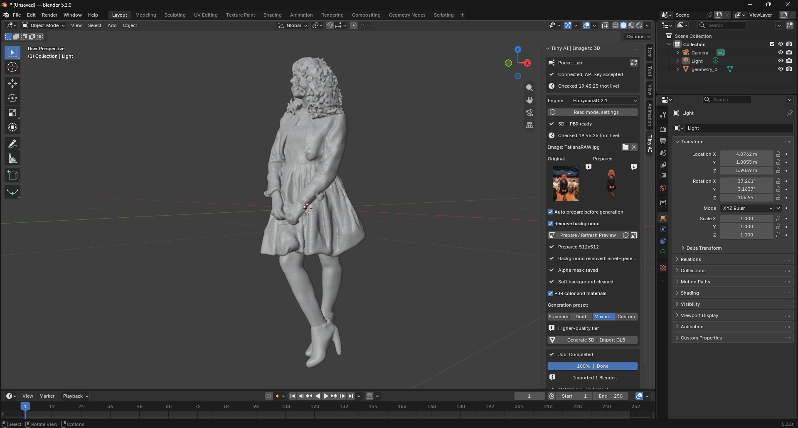
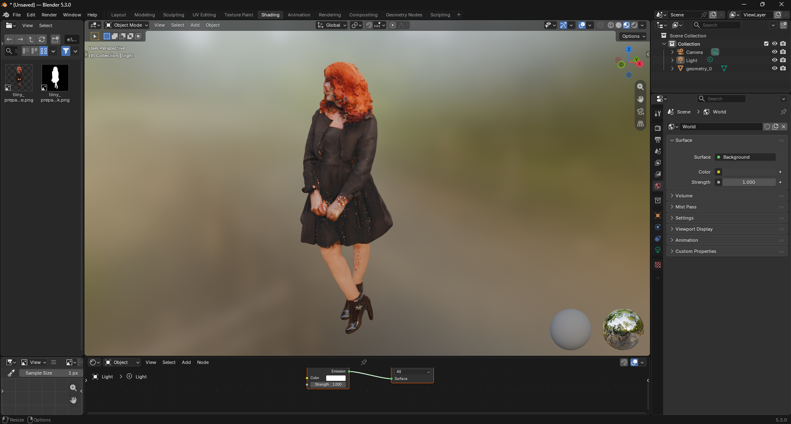

# Tiiny AI for Blender v0.1.0 — First Community Preview

**A community-made Blender extension for local image-to-3D generation with Tiiny AI Pocket Lab.**

This is the first community preview of **Tiiny AI for Blender**. The extension connects Blender directly to Tiiny, generates 3D models with **Hunyuan3D 2.1** or **TRELLIS.2 4B**, optionally creates PBR textures, and imports finished GLBs. No separate MCP server is needed.

## From inspiration to a real-world experiment

The project was inspired by the Tiiny AI video **[Tiiny x Blender: Limit Less, Create More](https://youtu.be/zodag03kS6o)**. I wanted to try an integration like the one shown, couldn't find that exact add-on, and eventually created my own after encouragement from other community members.

Many image-to-3D demos use small, simple subjects — often a rubber duck. That's a good starting point, but I wanted to challenge both the segmentation tool and the 3D model with something harder: an ordinary photograph of my friend **Tatiana**, used with her permission. Curly hair, layered clothing, a turned head, a natural pose and a complicated background made it a demanding example.

Without manually isolating the photo in Photoshop, the add-on prepared the image, and **Hunyuan3D 2.1 produced a recognizable textured 3D model on the first attempt**. It was not flawless, but the outcome surprised me and motivated the automatic image-preparation workflow.

*The 3D result shown in Blender. Demonstration published with the subject's permission.*

## Highlights

- Support for **Tencent Hunyuan3D 2.1** and **Microsoft TRELLIS.2 4B** on a local Tiiny Pocket Lab.
- Optional **PBR materials and color textures** with automatic GLB import.
- Optional **local background removal, soft-alpha cleanup, subject cropping and centering**.
- Direct-image mode: disable local image tools and use your own pre-prepared images.
- **Draft, Standard, Maximum and Custom** controls, plus model-specific advanced settings.
- Status and progress indicators, cancellation of local waiting, and diagnostic reports.
- No paid 3D cloud provider or extra Blender MCP bridge required.

## Install

**In the Assets section below, download `tiiny_ai_for_blender-0.1.0.zip`.**

Do **not** install GitHub's automatic **Source code (zip)** as the Blender extension. That is the repository source archive, not the extension installer.

1. Open Blender **4.3 or later** (demonstrated in Blender 5.3).
2. Go to **Edit → Preferences → Get Extensions → Install from Disk**.
3. Select the downloaded installer ZIP **without extracting it**.
4. Enable **Tiiny AI**, enter your Tiiny address and API key, and check the connection.
5. Choose the active Tiiny 3D model, select a photo in the **Tiiny AI** sidebar, and generate a GLB.

**[Read the Complete Illustrated User Guide](https://github.com/US4LKW/tiiny-ai-for-blender/blob/main/docs/USER_GUIDE.md)** — installation, connection, optional image tools, generation, materials, troubleshooting and uninstalling, all with screenshots.

## First-run note

Automatic local image preparation is enabled by default. On the first run, the extension may set up a private Python environment and download an ISNet segmentation model (approximately **180 MB** of model weights plus software dependencies). Setup may take a few minutes and its progress is displayed in Blender. Later runs reuse the cached tools.

**Don't need automatic background removal?** Uncheck **Use local image tools** in Preferences and use your own prepared reference image immediately.

## Known limitations

- This is a **community preview**, not an official Tiiny AI or Blender product.
- A compatible Tiiny Pocket Lab and a supported, running 3D model are required.
- TRELLIS.2 can produce holes, unwanted surfaces and other geometry defects. Its 1024/high mode remains experimental on Tiiny and requires explicit permission in Advanced settings.
- Neither engine guarantees a perfect reconstruction of unseen sides or anatomical details from a single photograph.
- Model performance and output quality vary with TiinyOS, input images and settings.
- Your API key is saved in local Blender preferences **without encryption**.

## Feedback and licensing

I'd be happy to hear about your results. If you discover better TRELLIS.2 settings, please share the model, TiinyOS version, preset, and a sanitized diagnostic JSON through [GitHub Issues](https://github.com/US4LKW/tiiny-ai-for-blender/issues).

**MIT License.** The software may be used, modified, and redistributed under its terms with required notices retained. Based in part on [Siddharth Ahuja's Blender MCP](https://github.com/ahujasid/mcp-for-blender). The demonstration images are shared for project documentation and are not included in the software's open-source license.

**[Project home](https://github.com/US4LKW/tiiny-ai-for-blender)** · **[Illustrated Guide](https://github.com/US4LKW/tiiny-ai-for-blender/blob/main/docs/USER_GUIDE.md)**
