# Tiiny AI for Blender — Complete Illustrated User Guide

**Blender 4.3+ · Tiiny AI Pocket Lab · Hunyuan3D 2.1 · TRELLIS.2 4B**

This guide explains installation, connection, first-use image preparation, generating and viewing a textured 3D model, updating, and uninstalling Tiiny AI for Blender. The screenshots were captured in **Blender 5.3 on Windows**; minor interface differences are possible in other supported versions.

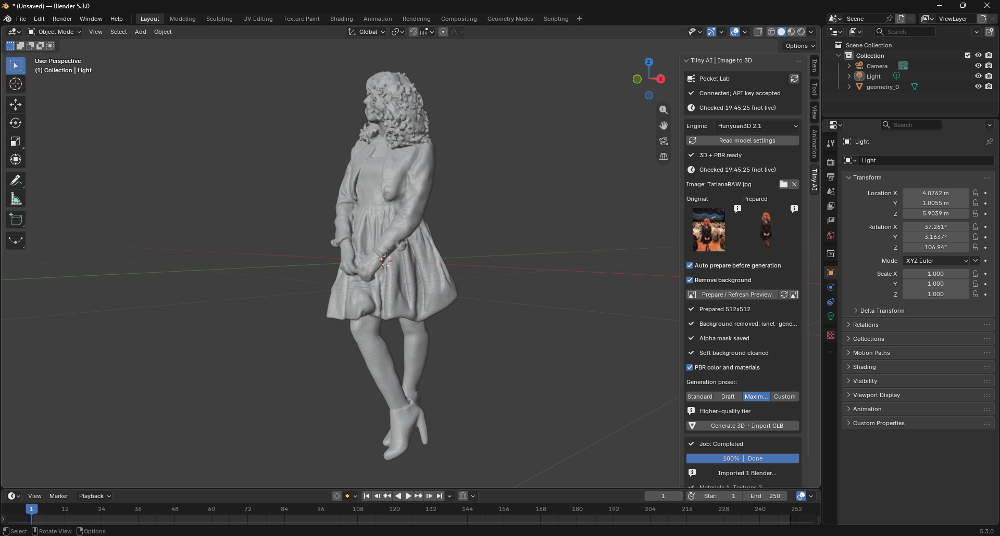

**Contents**

1. [Before you begin](#1-before-you-begin)
2. [Install the Blender extension](#2-install-the-blender-extension)
3. [Connect to your Tiiny Pocket Lab](#3-connect-to-your-tiiny-pocket-lab)
4. [Optional local image tools and first-time setup](#4-optional-local-image-tools-and-first-time-setup)
5. [Choose and prepare a reference image](#5-choose-and-prepare-a-reference-image)
6. [Generate your first 3D model](#6-generate-your-first-3d-model)
7. [View the model with PBR materials](#7-view-the-model-with-pbr-materials)
8. [Presets and advanced settings](#8-presets-and-advanced-settings)
9. [Uninstall, clean uninstall, and reinstall](#9-uninstall-clean-uninstall-and-reinstall)
10. [Troubleshooting](#10-troubleshooting)
11. [Example results — from photo to 3D](#11-example-results--from-photo-to-3d)

---

## 1. Before you begin

You need:

- **Blender 4.3 or newer** (the screenshots demonstrate Blender 5.3).
- A **Tiiny AI Pocket Lab**, accessible from the computer running Blender, with its API address and API key.
- At least one installed and **running** 3D engine on Tiiny: `Tencent/Hunyuan3d-2.1` or `microsoft/TRELLIS.2-4B`.
- A reference image (JPG or PNG, ideally showing one clear subject).
- If you enable automatic local image preparation: **Internet access during first setup**, some free disk space, and **uv** (on Windows: `winget install --id=astral-sh.uv -e` in PowerShell, then open a new shell).

The 3D model runs **on Tiiny**, not on your PC's graphics card. The optional segmentation model runs locally on your computer. **No extra Blender MCP server or paid cloud 3D API is required.**

**Important:** Keep your Tiiny API key private. The extension stores it in local Blender preferences **without encryption**. Do not put it into public source code, issue reports, or screenshots.

## 2. Install the Blender extension

### Step 1 — Open Preferences

Start Blender and choose **Edit → Preferences**.

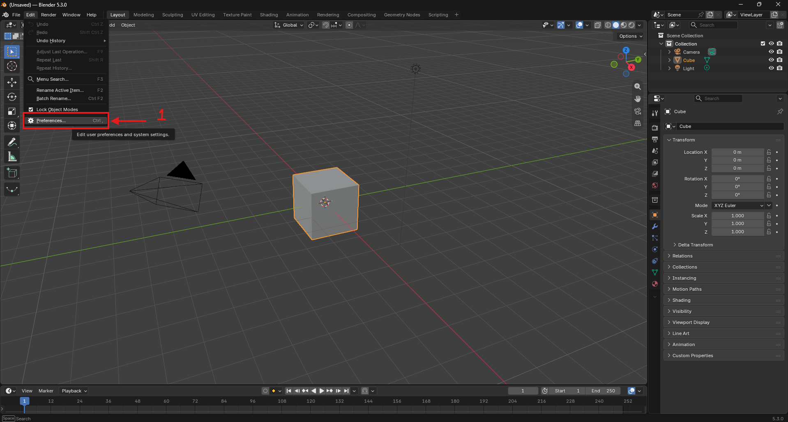

### Step 2 — Choose Install from Disk

Select **Get Extensions** in the Preferences sidebar. In the top-right menu, choose **Install from Disk**.

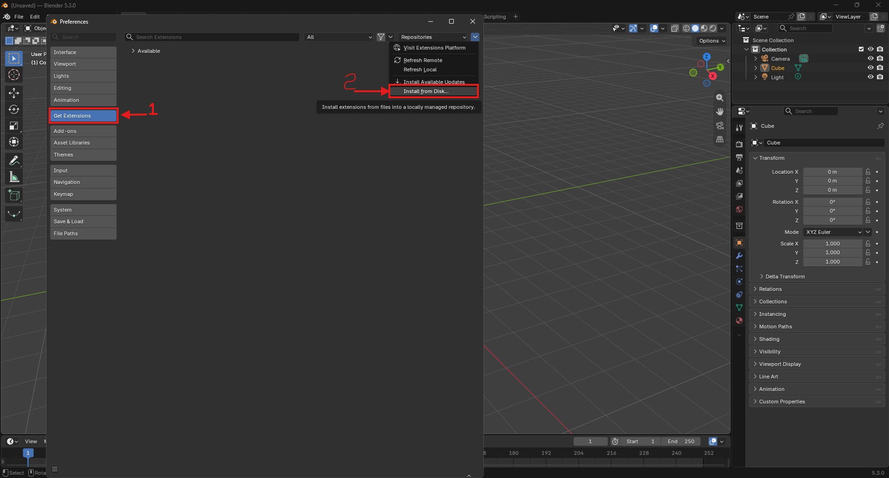

### Step 3 — Locate the extension after installation

Download **[`tiiny_ai_for_blender-0.1.0.zip`](../releases/tiiny_ai_for_blender-0.1.0.zip)**, then select **that ZIP without extracting it** in the file dialog. Use **Install from Disk** to finish. If an **Enable on Install** option is shown, keep it enabled.

Next open **Preferences → Add-ons**, search for **Tiiny AI**, and expand its entry. Its type should be **Extension** and its version should be **0.1.0**.

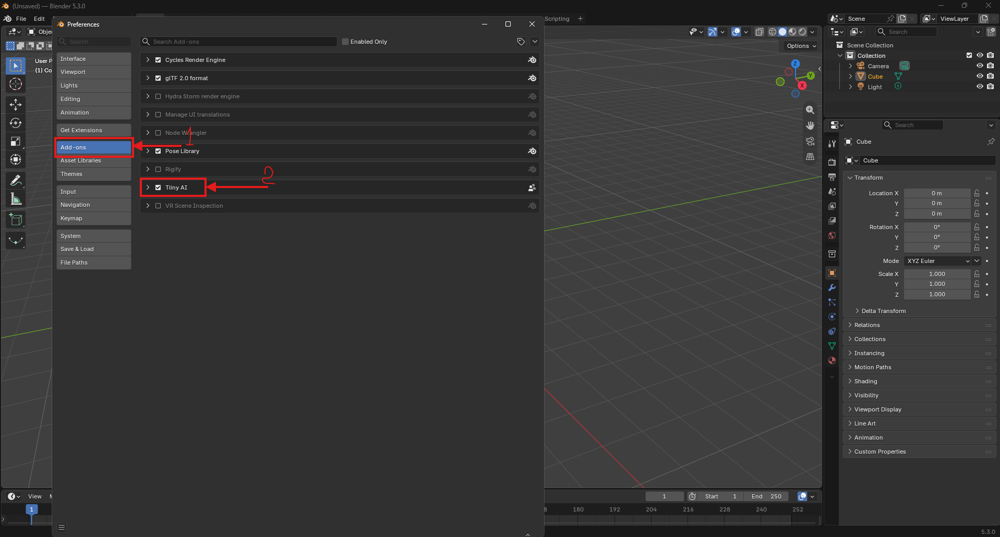

> **Do not install** the GitHub repository's automatically generated source ZIP as an extension. The ready-to-install file has `blender_manifest.toml` and `__init__.py` at the root. It installs under the unique extension ID `tiiny_ai_for_blender`.

## 3. Connect to your Tiiny Pocket Lab

Open the **Tiiny AI** entry under **Preferences → Add-ons**.

1. Set **Address** — for example, `http://tiinyhost.local`, or the IP address of your own Tiiny.
2. Paste your personal **API Key**.
3. Click **Check connection / API key**. On success you should see **Connected; API key accepted**.
4. Select **Hunyuan3D 2.1** or **TRELLIS.2 4B** under **3D model on Tiiny**. Make sure that model is **running on your Pocket Lab**, not merely installed.
5. Click **Refresh selected model settings**. A successful result may show **3D + PBR ready**.
6. Choose **Incoming photos** and **Generated models** folders. They can be the same, although separate directories are easier to organize.

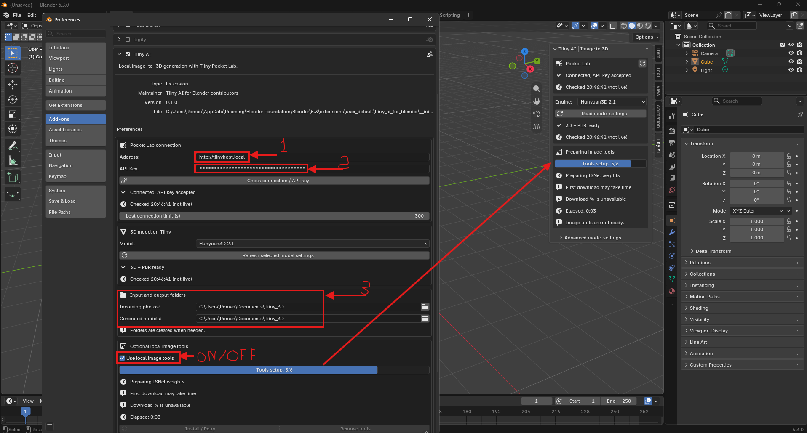

**The API connection check** and **the selected model readiness check** are separate. A valid API key does not mean a 3D engine is currently running.

## 4. Optional local image tools and first-time setup

Under **Optional local image tools**, the checkbox **Use local image tools** is enabled by default.

**When enabled:** Tiiny AI for Blender can automatically remove the background with ISNet/rembg, clean weak mask residue, crop the subject, center it, and resize it for the chosen 3D engine. The first use may create an isolated Python environment, install image libraries, and download segmentation weights of approximately **180 MB** (plus the Python packages). An Internet connection is required for these downloads.

While setup runs, a **setup progress bar** is visible both in Preferences and in the Tiiny AI sidebar. The stage percentage is a **setup-stage indicator, not a byte-accurate download percentage**. It is normal for the download step to take several minutes. The tools are cached for subsequent sessions.

**When disabled:** The optional tools are not required for generating 3D models. You choose an image that you have already prepared, and it is sent directly to Tiiny **without local background removal, cropping, or resizing**. No separate Prepared preview is shown. You can re-enable the tools later; already downloaded files are reused if still present.

**Useful controls in Preferences:**

- **Install / Retry** — install or repair the private environment.
- **Remove tools** — remove only the extension's own local image-processing dependencies and cached weights.
- **Clean Uninstall** — attempt to remove both the extension and its private tools. **Do not use this for ordinary upgrades.**
- **View local setup log** — open installation diagnostics if setup fails.

The original source photographs and final GLB files are **not deleted** by normal extension maintenance operations.

## 5. Choose and prepare a reference image

### Step 1 — Open the Tiiny AI sidebar

Back in Blender's **3D Viewport**, press **N** to show the right-hand sidebar. Click the **Tiiny AI** tab. Select your engine and click the folder button next to **Image**.

In the file browser, navigate to your reference photo, select it, and click **Choose reference image**.

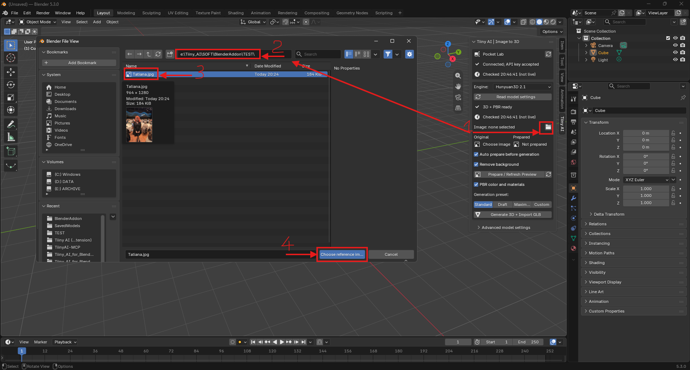

### Step 2 — Let the add-on prepare the photo

If local image tools are enabled, leave **Auto prepare before generation** and **Remove background** enabled. The sidebar shows the preparation stage and elapsed time. A first run may take longer while segmentation libraries or weights are initialized.

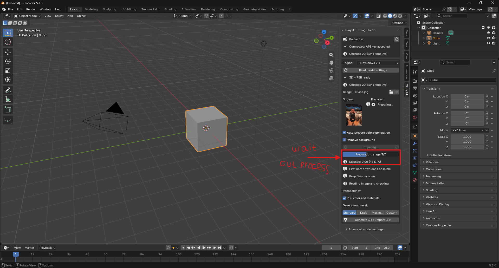

**Do not confuse preparation with generation:** ISNet creates a mask and a prepared PNG on your computer; Hunyuan3D or TRELLIS then generates the 3D model on Tiiny.

### Step 3 — Review the prepared image

Check the **Original** and **Prepared** thumbnails. The second preview should show the intended subject, centered and isolated with room around it. There are no file-name captions beneath the thumbnails. Hover over the small **information icon** beside a thumbnail to see the path to that image; clicking the information icon copies the path.

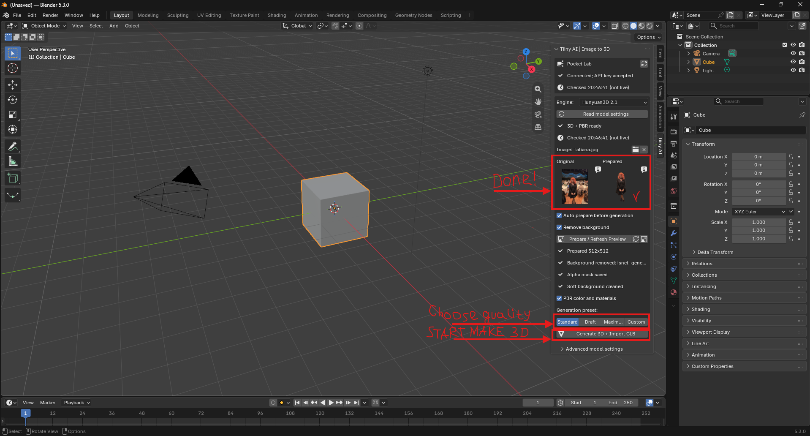

If the prepared image accidentally excludes an important feature, change the cleanup settings and click **Prepare / Refresh Preview** again.

**Advanced model settings → Reference image preparation** includes:

- **Crop to object** and **Object coverage** (approximately 0.85 by default).
- **Clean soft background**, on by default for masks freshly generated by the local segmentation model; it attempts to remove low-opacity residue such as faint shadows.
- **Clean existing alpha**, off by default so already-transparent files are not modified unexpectedly.
- Model-specific canvas preparation (current Auto recommendations: 512×512 for Hunyuan and 1024×1024 for TRELLIS; these are not hard API limits).

A single-image model can invent invisible geometry, and automatic segmentation is not infallible, especially on glass, hair, fine fibers, and semi-transparent surfaces. Always inspect the prepared result before generating.

## 6. Generate your first 3D model

1. Select **Hunyuan3D 2.1** or **TRELLIS.2 4B** and confirm model readiness.
2. Leave **PBR color and materials** enabled if you want a color-textured model; uncheck it for geometry-only output.
3. Select **Standard** for your first run. You can experiment with Draft, Maximum or Custom later.
4. Click **Generate 3D + Import GLB**. The progress widget shows stages such as **Shape**, **Texture**, and **Export** (and **Simplify** when selected).
5. Wait for **Job: Completed**. The extension saves a GLB and JSON diagnostics in your configured output folder and imports the GLB into the scene.

**If it seems to pause:** Texture baking and final export can take several minutes. The server may temporarily stop responding to status polls during heavy work. The add-on distinguishes continued waiting from an actual failure and offers **Stop generation**. Stopping local waiting does **not** guarantee that an unreachable Tiiny device stopped its remote computation.

**Keep the generated JSON report** when comparing quality presets or reporting bugs. Do not share secrets or unreviewed private paths in public issues.

## 7. View the model with PBR materials

A successfully imported mesh may appear gray in **Solid** viewport mode even when it contains color textures. Switch to **Material Preview** (the material-preview shading icon in the upper-right of the 3D Viewport) or the **Shading** workspace.

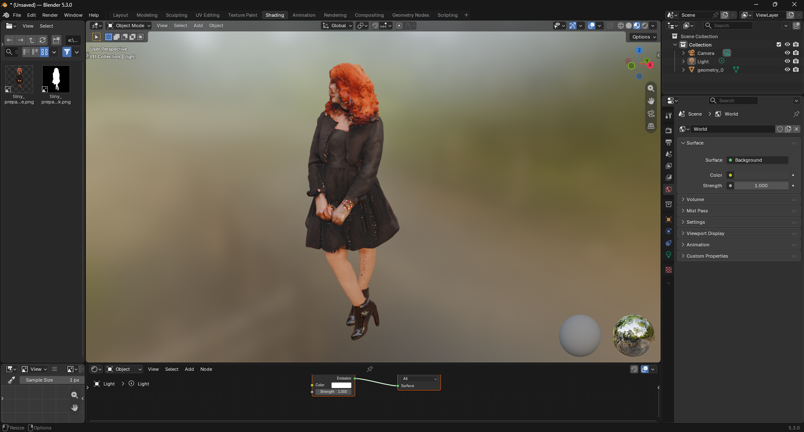

The example above shows an automatically isolated subject reconstructed and textured by Hunyuan3D 2.1 running on Tiiny. The original photograph is used with the subject's permission. **The result is a generated approximation, not a dimensionally accurate scan.**

## 8. Presets and advanced settings

| Option | Use |
| --- | --- |
| **Draft** | Faster/lower settings published by the Tiiny API; useful for initial checks. |
| **Standard** | Recommended baseline, generally using balanced quality. |
| **Maximum** | Highest advertised tier; **not guaranteed** to produce better geometry and can be considerably more resource-intensive. |
| **Custom** | User-selected overrides and detailed model-specific controls. |
| **PBR color and materials** | Toggle textured material generation on or off. |
| **Target polygons (0 = native)** | Desired face count for supported simplification; **not human-face detection**. |

**TRELLIS.2 caution:** Its Maximum/1024 mode is experimental on Tiiny and requires an explicit **Allow experimental 1024** switch in Advanced settings for the current session. A previously observed high-resolution run became unresponsive. Avoid Maximum until you are comfortable with the risks. Some TRELLIS outputs may include surface holes, rings, internal shells, or other artifacts. **Preserve detail 512** is an experimental cleanup profile, not a guaranteed repair.

For details see [API Parameters](API_PARAMETERS.md), [TRELLIS Diagnostics](TRELLIS_DIAGNOSTICS.md), and [Network and Cancellation](NETWORK_AND_CANCELLATION.md).

## 9. Uninstall, clean uninstall, and reinstall

### Keep cached tools when upgrading

To upgrade the extension while preserving previously downloaded ISNet weights, use the normal Blender extension **Uninstall**, close and restart Blender, and install the updated extension ZIP. **Do not use Clean Uninstall for ordinary upgrades.** Check API, model, and output-folder preferences afterward.

### Remove the extension and its local tools

If you deliberately want to remove both the extension and its **private** image-processing dependencies, open **Preferences → Add-ons → Tiiny AI**. Click **Clean Uninstall (add-on + tools)**.

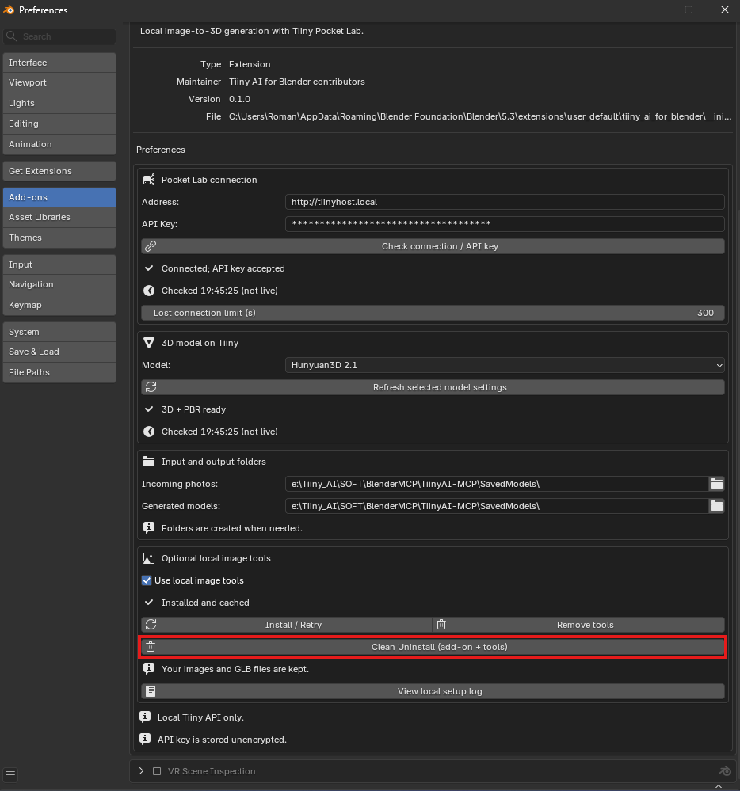

Blender asks you to confirm. Read the dialog, then click **OK** only if you want to remove the private tools as well. The extension may require you to finish removal through **Get Extensions** depending on Blender's context.

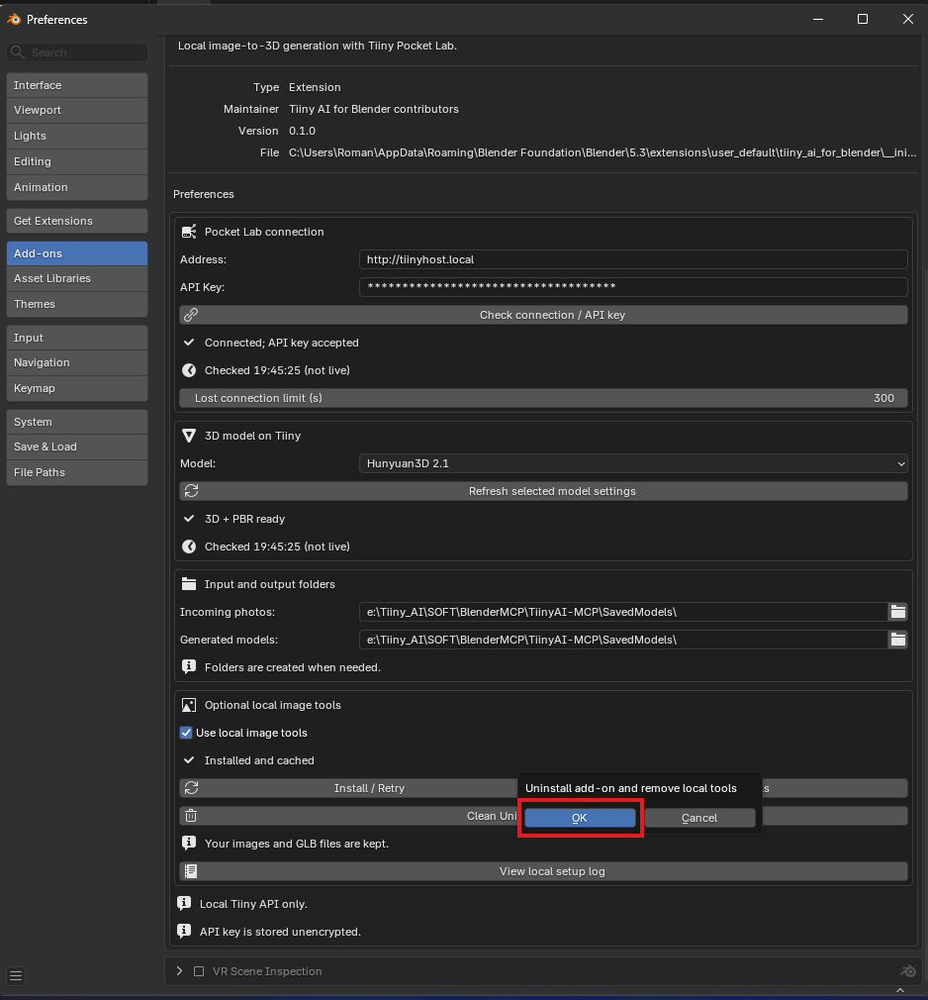

Your original photos, generated GLB files, and other projects' shared caches are not intentionally removed by this operation. You may need to enter the API address and key again when reinstalling.

### Reinstall after removal (optional)

If you want the extension back later, use **Get Extensions → Install from Disk** and select the ready-to-install ZIP again. The third screenshot here illustrates **reinstallation**, not an additional uninstall step.

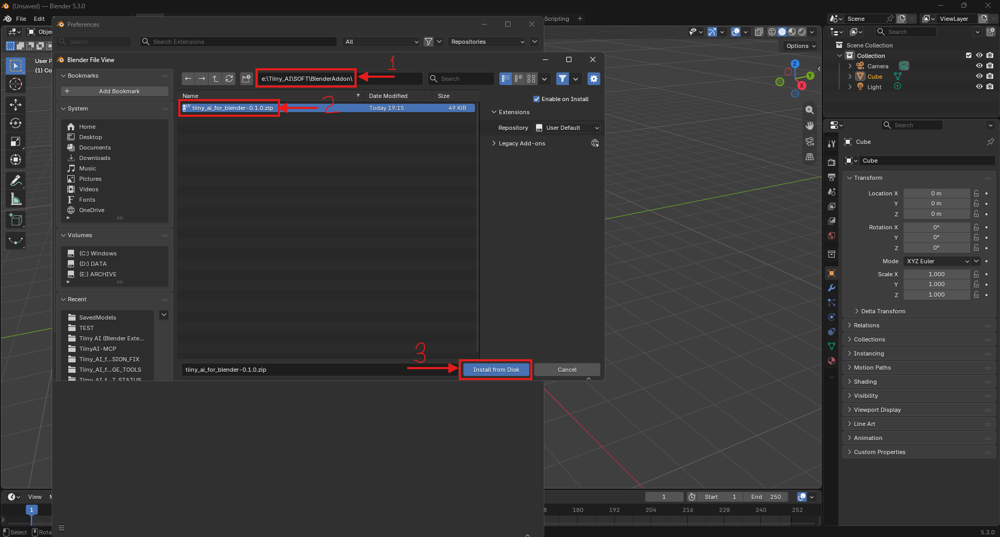

## 10. Troubleshooting

| Symptom | What to do |
| --- | --- |
| **API key rejected** | Recheck the full key and device address. A 401/403 response typically means authentication failed. |
| **Device not reachable** | Check network connectivity and hostname; after some Tiiny restarts, unlock the TiinyOS app before trying again. |
| **Model not ready** | Ensure the chosen 3D model is actually running on Tiiny, then click **Refresh selected model settings**. |
| **First-run setup takes a long time** | Setup may download Python packages and ISNet weights. Watch the setup-stage indicator and local log. |
| **Prepared preview is missing** | Confirm local tools are enabled and ready; try **Prepare / Refresh Preview**, then **Reload image thumbnails** if the PNG exists. |
| **Thin objects or shadows are cut out incorrectly** | Inspect the prepared PNG. Adjust mask cleanup or disable it for delicate transparent materials. |
| **Generated GLB is gray** | Enable PBR before generation, then use Blender's **Material Preview**. |
| **TRELLIS has mesh holes or extra geometry** | Try Standard/512, review transparency, and compare advanced cleanup settings with diagnostics; none guarantee perfect geometry. |
| **A job seems frozen** | Check the current stage and elapsed time. Avoid launching another heavy job on Tiiny while the first may still run. Stop only if necessary; a disconnected device cannot confirm remote cancellation. |
| **Installer not recognized** | Choose the ready-to-install `tiiny_ai_for_blender-0.1.0.zip`, not the repository source ZIP. |

More troubleshooting: [First Run](FIRST_RUN_IMAGE_PREPARATION.md), [Local Tools Setup](LOCAL_TOOLS_SETUP.md), [Background & Preview Troubleshooting](PREVIEW_BACKGROUND_TROUBLESHOOTING.md), and [Network and Cancellation](NETWORK_AND_CANCELLATION.md).

## 11. Example Results — From Photo to 3D

Congratulations! You now know how to install, configure, use and remove Tiiny AI for Blender. To finish, here is a real-world example of what its local workflow can achieve.

The original photograph was not manually isolated in an editor. The add-on prepared the subject and sent it to Hunyuan3D 2.1 running on Tiiny AI Pocket Lab. This demonstration is shared with Tatiana's permission.

### Workflow and generated geometry

### Final textured result

*An AI-generated interpretation of an ordinary photo. Results vary with input quality, model configuration, and hardware/software versions.*

**Now it's your turn:** experiment with your own photos and objects, and share reproducible parameter findings with the community. [Return to the project README](../README.md).
